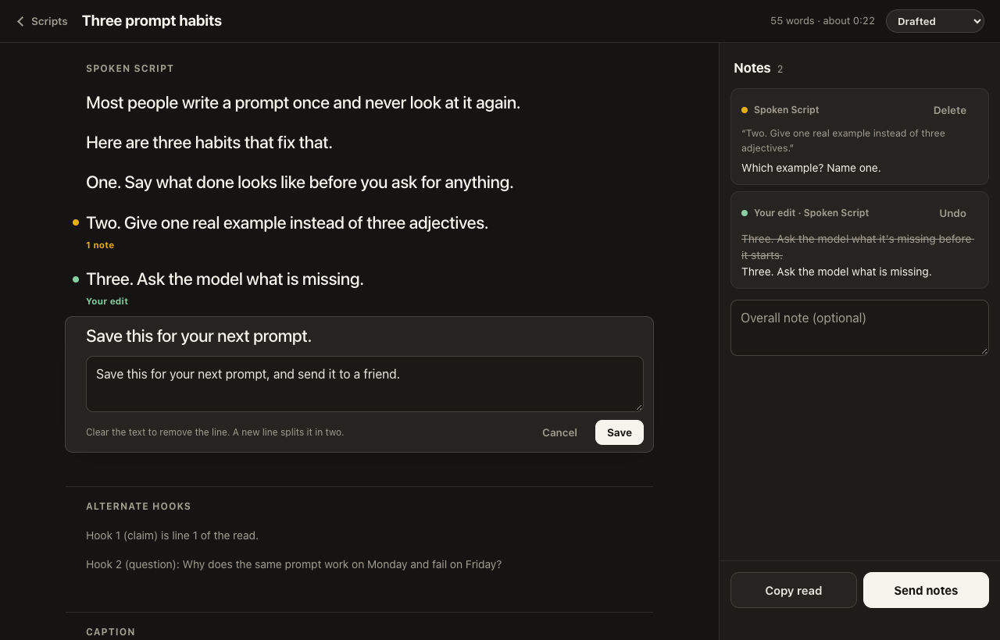
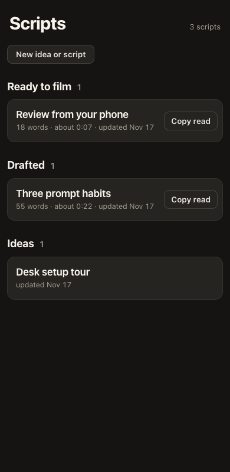

# reviewing-scripts

Review a video script in your browser and send line-by-line notes to your coding agent.

Your scripts stay as markdown files in a folder on your computer. A small local server shows each
script one line at a time. You comment on a line or on the words you selected, edit a line
directly, and click **Send notes**. Your agent revises the file from those notes. The page then
reloads and marks the lines that changed.

It ships as an agent skill and a Claude Code plugin. It needs Python 3.9 or later, with no packages
to install.



## What you can do on the page

- **Comment** on a line, or select a few words and comment on those.
- **Edit** a line. Clear the text to remove the line, or add a line break to split it in two.
- **Send notes.** Your edits save to the file first, then your notes go to the agent.
- **Looks good.** A send with no notes approves the draft and marks it ready.
- **Copy read.** Copies the spoken part as one paragraph, ready to paste into a teleprompter app.
- **Add an idea** from the list page, including from your phone.



## Install

### As a Claude Code plugin

```
/plugin marketplace add kjmagnan1s/reviewing-scripts
/plugin install reviewing-scripts@reviewing-scripts
```

### As a plain skill

Copy `skills/reviewing-scripts` into your agent's skills folder. For Claude Code that is
`~/.claude/skills/`.

## Try it

Ask your agent to draft a script and open it for review. To run it by hand:

```
cd skills/reviewing-scripts
python3 scripts/script_review.py new --title "Three prompt habits" --body-file draft.md --status drafted
python3 scripts/script_review.py up
python3 scripts/script_review.py open
python3 scripts/script_review.py wait <id>
```

`wait` prints your notes as markdown when you click **Send notes**. That output is what the agent
reads.

## How a script file looks

```markdown
---
type: script
id: 2026-01-15-three-prompt-habits
title: Three prompt habits
status: drafted
---

## Spoken Script

Most people write a prompt once and never look at it again.
Here are three habits that fix that.

## Alternate hooks

Hook 2 (question): Why does the same prompt work on Monday and fail on Friday?

## Caption

Three prompt habits worth keeping.
```

- **One sentence per line** in the read, so each line can take its own comment.
- **`Spoken Script`** is the read. A file without that section is all read.
- **`Alternate hooks`** is optional. **Copy read** adds each hook from hook 2 up after your last
  line, as "Two. Why does the same prompt...", so you can film alternate openings in the same take.
- **Other sections** are yours. They show on the page and take comments, and they're never copied.

## Settings

Settings live in `~/.config/reviewing-scripts/config.json`. Every setting is optional. To see the
settings in use, run `script_review.py config`.

```json
{
  "scripts_dir": "~/Documents/scripts",
  "reviewer": "Sam",
  "words_per_minute": 170,
  "tailscale": true
}
```

| Setting | Default | What it does |
|---|---|---|
| `scripts_dir` | `~/Documents/scripts` | The folder of script files. |
| `state_dir` | `~/.local/state/reviewing-scripts` | Notes, a copy of every version of every script, and the server log. |
| `port` | `8792` | The local port. |
| `title` | `Scripts` | The heading on the list page. |
| `reviewer` | `The reviewer` | Your name, as the notes say it. |
| `file_type` | `script` | Only files with this `type` in their frontmatter are listed. |
| `read_section` | `Spoken Script` | The section that **Copy read** copies. |
| `hooks_section` | `Alternate hooks` | The section that holds alternate hooks. |
| `sections` | `[]` | Other headers to recognize when they're written without `##`. |
| `words_per_minute` | `150` | Used for the "about 0:24" estimate. |
| `statuses` | idea, drafted, ready, filmed, posted | Status ids and their labels, in order. |
| `list_order` | ready, drafted, idea, filmed, posted | The order of groups on the list page. |
| `collapsed` | filmed, posted | Groups the list page shows folded. |
| `idea_status`, `draft_status`, `approved_status` | `idea`, `drafted`, `ready` | Which status a new idea gets, which a new draft gets, and which **Looks good** sets. |
| `alias_fields` | `[]` | Frontmatter fields that hold another id for the same script, such as the id from the tool you imported it from. |
| `tailscale` | `false` | Serve the page to your own devices. See the next section. |

`SCRIPT_REVIEW_CONFIG` points to a different config file. `SCRIPT_REVIEW_DIR`,
`SCRIPT_REVIEW_STATE`, and `SCRIPT_REVIEW_PORT` override the matching settings.

## Open it on your phone

The server only answers on your own computer. To reach it from your phone without putting it on
the public internet, use [Tailscale](https://tailscale.com):

1. Install Tailscale on the computer and the phone, and sign in to the same account on both.
2. Turn on HTTPS certificates for your Tailscale network. Phone browsers only allow **Copy read**
   on an `https` page.
3. Set `"tailscale": true` in the config file and run `script_review.py up`. It prints the phone
   address.
4. Open that address on the phone and add it to your home screen.

Only devices signed in to your Tailscale account can open the page.

## Security

Notes go to an agent and edits go to a file, so the server accepts them only from its own pages:

- It listens on `127.0.0.1` only, and refuses requests for any other host name. This blocks DNS
  rebinding.
- Every write needs a token that only the served page holds, sent in a header that another site
  can't set.
- Pages run under a content security policy that allows only their own scripts.
- It serves no files from disk: the list, a script page, and a small API.

The server keeps a copy of every version of every script in the state folder, so an overwrite
never loses text.

## Tests

```
python3 tests/test_script_page.py
```

The tests run in a temporary folder on a free port and don't touch your scripts.

## License

MIT
